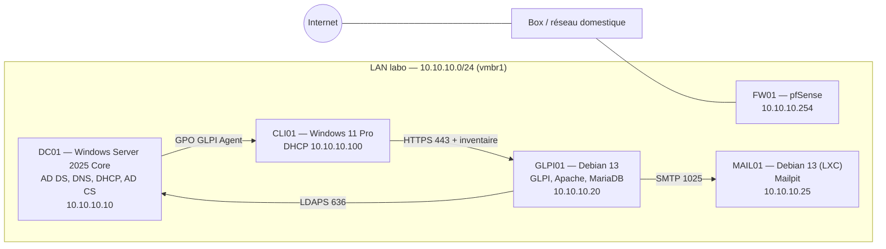

# TP GLPI niveau 2 — Infrastructure complète sous Proxmox

Laboratoire réalisé dans le cadre de ma préparation au titre RNCP 37680 « Administrateur d'Infrastructures Sécurisées ». L'objectif : monter de bout en bout une petite infrastructure d'entreprise autour de GLPI, avec un domaine Active Directory, une PKI interne, de l'authentification LDAPS, des notifications par mail et un inventaire automatique des postes déployé par GPO.

## Architecture



| Machine | Type | Système | Adresse | Rôle |
| --- | --- | --- | --- | --- |
| FW01 | VM 100 | pfSense CE 2.7.2 | 10.10.10.254 | Passerelle, NAT, pare-feu |
| DC01 | VM 101 | Windows Server 2025 Core | 10.10.10.10 | AD DS, DNS, DHCP, autorité de certification |
| GLPI01 | CT 102 | Debian 13 | 10.10.10.20 | GLPI, Apache en HTTPS, MariaDB |
| MAIL01 | CT 200 | Debian 13 | 10.10.10.25 | Serveur SMTP de test (Mailpit) |
| CLI01 | VM 103 | Windows 11 Pro | DHCP | Poste utilisateur, console RSAT/GPMC |

Domaine : `labo-ais.lan` (NetBIOS `LABOAIS`).

## Ce qui a été mis en place

- Réseau isolé derrière pfSense, DHCP et DNS assurés par le contrôleur de domaine.
- Annuaire organisé en OU, groupes `GG-GLPI-*` et comptes de test, compte de service dédié à la lecture LDAP.
- PKI d'entreprise (LABO-AIS-CA) : certificat HTTPS de GLPI signé en interne, LDAPS actif sur DC01, racine distribuée par GPO.
- GLPI servi uniquement en TLS 1.2/1.3, avec redirection HTTP vers HTTPS, en-têtes de sécurité et cookies de session sécurisés.
- Connexion à GLPI avec le compte AD, profil attribué selon le groupe (Super-Admin, Technicien, Self-Service), synchronisation planifiée.
- Notifications de tickets envoyées par SMTP et contrôlées dans Mailpit.
- GLPI Agent déployé sur les postes du domaine par un script de démarrage en GPO, avec la CA interne.

## État d'avancement

| Étape | Contenu | État |
| --- | --- | --- |
| 1 | Réseau Proxmox et création des machines | Fait |
| 2 | Active Directory et DNS | Fait |
| 3 | DHCP et jonction de CLI01 | Fait |
| 4 | Autorité de certification (AD CS) | Fait |
| 5 | Installation de GLPI | Fait |
| 6 | Sécurisation HTTPS | Fait |
| 7 | Liaison LDAPS avec l'AD | Fait |
| 8 | Notifications SMTP | Fait |
| 9 | Déploiement de GLPI Agent par GPO | En finalisation |
| 10 | Sauvegarde GLPI et Proxmox, test de restauration | À faire |
| 11 | Durcissement final | À faire |

## Contenu du dépôt

```
docs/        procédure complète du TP et captures de preuve
scripts/     scripts PowerShell, batch et Bash utilisés
config/      fichiers de configuration (Apache, systemd, cron)
```

## Écarts entre la procédure et la réalisation

- DC01 tourne sous Windows Server 2025 Core au lieu de 2022.
- CLI01 est en Windows 11 Pro (25H2) : l'édition Pro suffit pour la jonction au domaine.
- Le labo tourne dans un Proxmox virtualisé sur un PC portable. Les performances limitées m'ont obligé à n'allumer que les machines utiles à chaque étape.
- Pendant l'installation de Windows 11, le pilote réseau VirtIO a dû être installé à la main (`pnputil`) car l'assistant expirait (erreur 0x800705b4).

## Points de vigilance rencontrés

- Une alerte de nouveau ticket n'arrivait pas au technicien : il manquait le destinataire « Groupe chargé du ticket » dans la notification GLPI.
- Une VM Windows ne démarrait pas sur l'ISO parce que l'ordre de boot pointait sur l'ISO des pilotes VirtIO.
- `Add-Computer` renvoyait « Accès refusé » depuis un PowerShell non élevé.

## Auteur

Jean Marie Casseus — administrateur systèmes et réseaux, titulaire du titre AIS (RNCP 37680).
