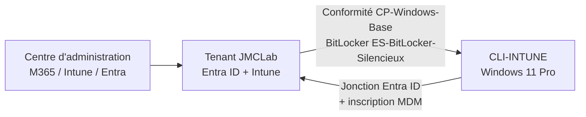

# TP Intune — Gestion d'un poste Windows 11 depuis le cloud

Laboratoire réalisé dans le cadre de mon parcours AIS (RNCP 37680). Après le TP GLPI, où le poste était géré par GPO dans un domaine Active Directory local, je voulais voir l'équivalent côté cloud : un poste Windows 11 joint à Entra ID, inscrit dans Microsoft Intune, contrôlé par une stratégie de conformité et chiffré avec BitLocker sans intervention de l'utilisateur.

Ce README couvre la séance 1, faite dans la nuit du 8 au 9 novembre 2026.

## Environnement

| Élément | Détail |
| --- | --- |
| Tenant | `JMCLab.onmicrosoft.com`, essai Microsoft 365 Business Premium (un mois) |
| Utilisateur de test | `user01`, emplacement d'utilisation France, licence Business Premium |
| Poste | VM VirtualBox `CLI-INTUNE`, Windows 11 Pro |
| Matériel virtuel | EFI, Secure Boot, TPM 2.0, 4 Go de RAM, disque de 64 Go |



## Ce qui a été fait

1. **Tenant d'essai** : création du tenant Business Premium et du compte administrateur.
2. **Inscription automatique** : dans le centre d'administration Intune, *Appareils > Inscription > Windows > Inscription automatique*, étendue utilisateur MDM réglée sur « Tous ». Tout utilisateur qui joint un appareil part directement dans Intune.
3. **Utilisateur de test** : création de `user01` dans la console Utilisateurs d'Entra ID, avec l'emplacement d'utilisation France. La licence Business Premium, elle, a été attribuée depuis le centre d'administration Microsoft 365 : Entra ne permet plus de le faire.
4. **Poste client** : installation de Windows 11 Pro puis jonction Entra ID dès l'OOBE avec `user01`. L'appareil apparaît dans Intune tout seul, avec la propriété « Entreprise ».
5. **Paramètre du tenant** : un appareil sans stratégie de conformité affectée est marqué non conforme. Par défaut il serait considéré conforme, ce qui laisse passer n'importe quoi.
6. **Groupe dynamique** `GRP-PC-Windows`, groupe de sécurité avec la règle :

   ```
   (device.deviceOSType -eq "Windows") and (device.managementType -eq "MDM")
   ```

   Seuls les postes Windows réellement gérés par Intune y tombent, ce qui évite de cibler des appareils simplement enregistrés.
7. **Stratégie de conformité** `CP-Windows-Base`, affectée au groupe : chiffrement du disque, pare-feu, TPM, antivirus, anti-espion, Microsoft Defender actif, signatures à jour, protection en temps réel.
8. **Profil BitLocker** `ES-BitLocker-Silencieux` (Sécurité du point de terminaison > Chiffrement de disque) :
   - chiffrement silencieux, sans invite pour l'utilisateur ;
   - protecteur TPM seul, sans PIN ni clé de démarrage ;
   - clé de récupération sauvegardée dans Entra ID **avant** l'activation du chiffrement ;
   - rotation du mot de passe de récupération activée.

## Incidents et résolutions

### 1. Installation de Windows 11 bloquée

**Symptôme** : l'installateur refuse de continuer, message indiquant que TPM 2.0 et le démarrage sécurisé sont requis.

**Cause** : la VM avait été créée sans EFI, sans Secure Boot et sans TPM.

**Correction** : dans VirtualBox, *Système > Carte mère* : activation d'EFI et du démarrage sécurisé, TPM réglé sur 2.0. L'installation passe ensuite normalement.

### 2. BitLocker appliqué « en Réussite » mais disque non protégé

**Symptôme** : dans Intune, le profil `ES-BitLocker-Silencieux` affiche Réussite. Sur le poste, `manage-bde -status C:` indique pourtant « Protection désactivée » et aucun protecteur de clé.

**Démarche** :
- rapport du profil dans Intune : rien d'anormal ;
- `tpm.msc` : TPM présent, prêt à l'emploi ;
- Observateur d'événements, journal *Applications et services > Microsoft > Windows > BitLocker-API > Management* : **événement 853**, BitLocker détecte un média de démarrage amovible et refuse d'activer la protection.

**Cause** : l'ISO de Windows était toujours insérée dans le lecteur optique virtuel de la VM.

**Correction** : éjection de l'ISO, redémarrage. Au retour, la protection est activée, avec deux protecteurs : TPM et mot de passe numérique (la clé de récupération, visible dans Entra ID).

À retenir : le statut « Réussite » d'un profil veut dire que les paramètres sont arrivés sur le poste, pas que le chiffrement a abouti. Il faut vérifier côté poste.

### 3. Appareil non conforme sur la veille de sécurité Defender

**Symptôme** : l'appareil reste non conforme, seul le paramètre lié à Defender (signatures à jour) est en échec.

**Cause** : VM neuve, les signatures antivirus n'avaient pas encore été mises à jour.

**Correction** : `Update-MpSignature` dans un PowerShell administrateur. Premier essai en erreur `0x800706be` (Defender encore occupé avec sa propre mise à jour en arrière-plan), relancée aussitôt, la deuxième commande s'est terminée sans erreur. Après synchronisation, l'appareil est conforme sur les 8 paramètres.

## Captures


## Ce que j'ai appris

- L'inscription automatique repose sur deux choses : l'étendue MDM réglée dans Intune et une licence qui inclut Intune. Sans emplacement d'utilisation, pas de licence possible.
- Un groupe dynamique bien filtré (OS + type de gestion) évite d'appliquer des stratégies à des appareils qui ne devraient pas être ciblés.
- Marquer non conformes les appareils sans stratégie est un réglage à faire dès le départ, sinon un poste oublié passe pour conforme.
- Pour BitLocker, la console Intune ne suffit pas. `manage-bde`, `tpm.msc` et le journal BitLocker-API/Management donnent la vraie raison d'un échec.
- Un média amovible présent au démarrage (même une ISO virtuelle) bloque le chiffrement silencieux.
- Sur un poste fraîchement installé, la conformité peut échouer simplement parce que Defender n'a pas encore eu le temps de se mettre à jour.

## Prochaine séance

1. **Accès conditionnel** : n'autoriser l'accès aux applications Microsoft 365 qu'aux appareils conformes.
2. **Déploiement de 7-Zip en application Win32** : empaquetage du MSI en `.intunewin` puis déploiement sur `GRP-PC-Windows`.

Les binaires ne sont pas versionnés (voir `.gitignore`), voici les liens :

- 7-Zip : <https://www.7-zip.org/download.html>
- Microsoft Win32 Content Prep Tool : <https://github.com/microsoft/Microsoft-Win32-Content-Prep-Tool>

## Auteur

Jean Marie Casseus — administrateur systèmes et réseaux, titulaire du titre AIS (RNCP 37680).
