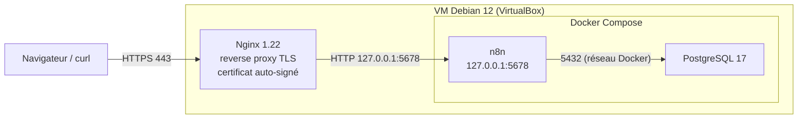
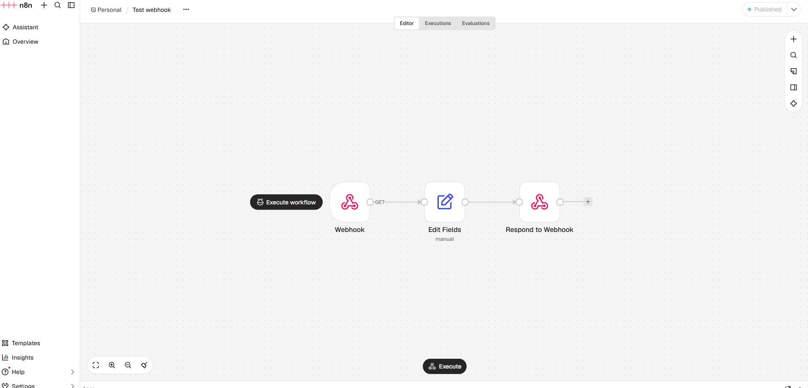

# TP n8n — Automatisation auto-hébergée en HTTPS

Laboratoire réalisé dans le cadre de ma préparation au titre « Administrateur d'Infrastructures Sécurisées ». L'objectif : déployer n8n, un outil d'automatisation de workflows, sur une VM Debian 12, avec une base PostgreSQL, le tout orchestré par Docker Compose et publié en HTTPS derrière un reverse proxy Nginx. Pour valider l'installation, j'ai créé un premier workflow déclenché par un webhook.

## Architecture



| Composant | Rôle |
| --- | --- |
| Debian 12 | Système de la VM, hébergée dans VirtualBox |
| Nginx | Terminaison TLS, redirection HTTP → HTTPS, proxy vers n8n (WebSocket compris) |
| n8n | Moteur de workflows, accessible uniquement en local sur le port 5678 |
| PostgreSQL 17 | Base de données de n8n (workflows, exécutions, identifiants) |

Nom d'hôte utilisé : `n8n.labo.local`.

Quelques choix de sécurité :

- n8n écoute uniquement sur `127.0.0.1` : on ne peut l'atteindre qu'en passant par Nginx.
- PostgreSQL n'expose aucun port sur l'hôte, seul n8n y accède via le réseau Docker.
- Les conteneurs tournent avec `no-new-privileges`.
- Les cookies de session sont marqués `Secure` (`N8N_SECURE_COOKIE=true`).
- Seuls TLS 1.2 et 1.3 sont acceptés.
- Les mots de passe sont dans un fichier `.env`, non versionné.

## Contenu du dossier

| Fichier | Description |
| --- | --- |
| [`docker-compose.yml`](docker-compose.yml) | Services `postgres` et `n8n` |
| [`.env.example`](.env.example) | Modèle des variables d'environnement, sans secret |
| [`nginx/n8n.conf`](nginx/n8n.conf) | Virtual host Nginx (HTTP → HTTPS, reverse proxy) |
| [`workflows/test-webhook.json`](workflows/test-webhook.json) | Export du workflow de test, importable dans n8n |
| [`docs/captures/`](docs/captures/) | Capture d'écran du workflow |

## Étapes

### 1. Préparer la VM

Installation de Debian 12 dans VirtualBox. Après l'installation, `sudo` n'était pas présent (voir [Problèmes rencontrés](#problèmes-rencontrés)). Je l'ai installé en root, puis j'ai ajouté mon utilisateur au groupe `sudo` :

```bash
su -
apt update && apt install -y sudo
usermod -aG sudo <utilisateur>
```

Il faut ensuite se déconnecter et se reconnecter pour que le groupe soit pris en compte.

### 2. Installer Docker et Nginx

Installation de Docker Engine avec le plugin Compose (dépôt officiel Docker), puis de Nginx et OpenSSL :

```bash
sudo apt install -y nginx openssl
```

### 3. Lancer n8n et PostgreSQL

```bash
cd tp-n8n
cp .env.example .env
nano .env          # mettre un vrai mot de passe PostgreSQL
sudo docker compose up -d
sudo docker compose ps
```

n8n attend que PostgreSQL soit prêt (`healthcheck` + `depends_on: condition: service_healthy`) avant de démarrer. Les données sont conservées dans les dossiers `postgresql/`, `n8n_data/` et `n8n_files/`, créés à côté du `docker-compose.yml`.

### 4. Générer le certificat auto-signé

```bash
sudo mkdir -p /etc/nginx/ssl
sudo openssl req -x509 -nodes -days 365 -newkey rsa:2048 \
  -keyout /etc/nginx/ssl/n8n.key \
  -out /etc/nginx/ssl/n8n.crt \
  -subj "/CN=n8n.labo.local" \
  -addext "subjectAltName=DNS:n8n.labo.local"
sudo chmod 600 /etc/nginx/ssl/n8n.key
```

### 5. Configurer Nginx

```bash
sudo cp nginx/n8n.conf /etc/nginx/sites-available/n8n
sudo ln -s /etc/nginx/sites-available/n8n /etc/nginx/sites-enabled/
sudo nginx -t
sudo systemctl reload nginx
```

Sur le poste client, ajouter `n8n.labo.local` dans le fichier `hosts`, pointant vers l'IP de la VM. Le navigateur affiche un avertissement au premier accès, ce qui est normal avec un certificat auto-signé.

### 6. Premier workflow : webhook

Le workflow **Test webhook** comporte trois nœuds :

1. **Webhook** : reçoit une requête `GET` sur `/webhook/test` ;
2. **Edit Fields** : construit un champ `message` à partir du paramètre `nom` de l'URL ;
3. **Respond to Webhook** : renvoie le résultat au client.



Pour l'importer : dans n8n, *Create workflow* → menu `...` → *Import from File* → `workflows/test-webhook.json`, puis publier le workflow.

Test depuis le poste client (`-k` car le certificat est auto-signé) :

```bash
curl -k "https://n8n.labo.local/webhook/test?nom=Jean"
```

Réponse attendue :

```json
{"message":"Bonjour Jean"}
```

## Problèmes rencontrés

### `sudo` absent après l'installation de Debian

**Symptôme :** `sudo: command not found`.

**Cause :** quand on définit un mot de passe root pendant l'installation de Debian, le paquet `sudo` n'est pas installé et l'utilisateur créé n'a aucun droit d'administration.

**Solution :** passer root avec `su -`, installer `sudo` et ajouter l'utilisateur au groupe `sudo` (voir l'étape 1).

### Directive `http2 on;` refusée par Nginx

**Symptôme :** `nginx -t` renvoie une erreur `unknown directive "http2"`.

**Cause :** la directive séparée `http2 on;` n'existe qu'à partir de Nginx 1.25.1. Debian 12 fournit Nginx 1.22, qui ne la connaît pas.

**Solution :** activer HTTP/2 à l'ancienne, directement sur la ligne `listen` :

```nginx
listen 443 ssl http2;
```

## Pistes d'amélioration

- Remplacer le certificat auto-signé par un certificat signé par une autorité interne, ou par Let's Encrypt si le service est exposé.
- Fixer la version de l'image n8n plutôt que d'utiliser la dernière.
- Sauvegarder régulièrement la base PostgreSQL (`pg_dump`) et le dossier `n8n_data/`, qui contient la clé de chiffrement des identifiants.
- Ajouter les en-têtes de sécurité HTTP (HSTS, etc.) dans Nginx.
